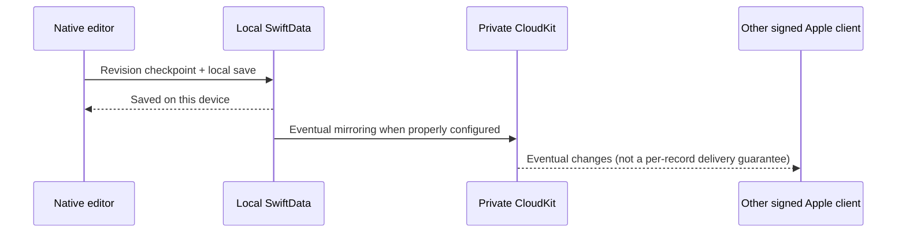

# Architecture

The browser is a complete React/TypeScript client, not the native app's website shell. The two Apple targets compile the same native SwiftUI sources. `TeleoCore` is a separately testable Swift package; Xcode targets compile its sources directly to avoid package resolution at build time. No proprietary assets, WebViews or third-party font services are used.

| Owner | Responsibility |
|---|---|
| `packages/protocol/domain.ts`, `apps/apple/Sources/TeleoCore` | Portable script/preferences, command validation, time-based playback |
| `apps/web/src/storage.ts` | IndexedDB v1, revisions, folders, retained tombstones |
| `apps/web/src/main.tsx` | Host UI, requestAnimationFrame, scoped keyboard adapter, screen wake lifecycle |
| `apps/web/src/i18n.ts` | Typed en/uk/ru dictionaries and browser preference detection |
| `services/remote-relay/worker.ts` | Browser pairing/commands and permissioned ephemeral preview, hibernating Durable Objects |
| `apps/apple/Shared` | SwiftUI editor, native text layout/scroll views, keyboard adapter, Network.framework transport |
| `apps/apple/Sources/TeleoCore/Storage.swift` | Versioned SwiftData schema and CloudKit opt-in configuration |

Each host owns playback. Commands are `play`, `pause`, `togglePlay`, `restart`, `speedUp`, `speedDown`, `setSpeed`, paragraph jumps and ±100-point scroll. Speed is 0.5–3 in increments of 0.25; scrolling is 40 points/sec × speed. Frame delta is capped at 50ms. Native TimelineView's animation schedule drives native scroll offset updates; text layout is cached between changes. Browser requestAnimationFrame uses the same clock semantics. Pause, backgrounding and reader dismissal reset clock history. Manual scrolling pauses. Paragraph jumps use rendered paragraph geometry. Mirroring applies only to text.

```mermaid
sequenceDiagram
  participant H as Browser host
  participant R as Durable Object relay
  participant P as Phone browser
  H->>R: Create room (Origin + creation rate limit)
  R-->>H: Public room ID + host capability + 256-bit invite
  H-->>P: QR /remote#pair=room.invite
  H->>R: WebSocket host auth (capability in first frame)
  P->>R: WebSocket one-use invite auth, 120s TTL
  R->>H: Approval requested
  H->>R: Allow
  R-->>P: Connected
  P->>R: Request ID + allowlisted command
  R->>H: Deduplicated command
  H->>R: ACK + numeric playback state
  R->>P: ACK (matching outstanding ID)
  H->>R: Revoke
  R-->>P: Close; invalidate resume capabilities
```

```mermaid
sequenceDiagram
  participant M as Native Mac host
  participant I as Native iPhone
  M->>M: Explicitly enable listener; generate 256-bit PSK
  M-->>I: Transfer private invitation (120s); Bonjour discovery
  I->>M: Network.framework TLS 1.2 PSK authentication
  M->>M: User approves control
  M-->>I: Approved
  I->>M: Session ID + request ID + command
  M->>M: Gate validates authorization, expiry, replay and command
  M-->>I: ACK + playback state (no title/body)
  M->>M: Revoke / background / close cancels connection
```



CloudKit is never used as a remote-control transport. Web and Apple libraries are separate. Cross-browser/native remote interoperability is not implemented. No automatic concurrent text merge is claimed. Read QA_REPORT for the current implementation and verification limits.

## Browser recovery ownership

The relay is authoritative for resume authorization and the 30-second detached-role deadlines. `RemoteLink` owns a tab-local 25-second recovery budget and never persists resume secrets or command queues. Only the host owns playback; a lost network ACK is not proof that a command failed to execute. Fresh state is requested after each socket replacement and sequence-checked by the controller. `Room` persists role-specific hashed resume capabilities, active connection IDs, replay ledger and state sequence; WebSocket attachments carry their socket ID and rate window across hibernation. All mutations remain serialized by the Durable Object concurrency gate. Native LAN recovery is unchanged and separate.

## Current web presentation

The complete website redesign adds `ui.tsx` (icons, segmented buttons, native dialog sheet) and `Intro.tsx` (session-only entry overlay). `/` and `/studio` now resolve to the same workspace. The animation never covers `/remote` invitations. Storage/domain/relay modules remain unchanged; local visual preferences are separate from portable script fields. See docs/design/TELEO_UI_ARCHITECTURE.md and docs/audits/TELEO_UI_REDESIGN_REPORT.md for the current layout and verification.

## v0.3.1 Studio / phone preview

menus.tsx centralizes native top-layer selects/action menus; RemoteController.tsx composes the phone UI and clipped speed geometry; feedback.ts feature-detects optional vibration. Shared packages/protocol/preview.ts defines validated ephemeral snapshots/positions and memory-only receiver assembly; host-preview.ts debounces/chunks allowed revisions. Durable Objects persist only consent bits/epochs and existing auth/counters, never content. The host remains the sole script/playback source. See docs/design/TELEO_REMOTE_V03.md and docs/audits/TELEO_V03_UI_AUDIT.md.


## v0.6 approved remote and pairing UI

RemoteController.tsx supersedes the older wings/tabs composition with approved dark closed/quick-sheet states and a separate advanced sheet. ActionDialog.tsx reuses the focus-contained Sheet for name/confirmation flows. `packages/protocol/control.ts` defines strict optional numeric control metadata and targeted seek/preference commands on the existing command/ACK channel. It rejects content/unknown fields; host-generated targets prevent applying stale commands after script/body changes. Remote font/spacing/width and secondary settings are ACK-backed; host preference storage and engine remain the single source. Real paragraph markers are sampled from host layout only with preview consent. Pairing UI state is independent of session authorization and guarded against stale async completions. See docs/engineering/TELEO_PAIRING_AND_SYNC_V06.md for exact behavior. No native or IndexedDB schema change.
