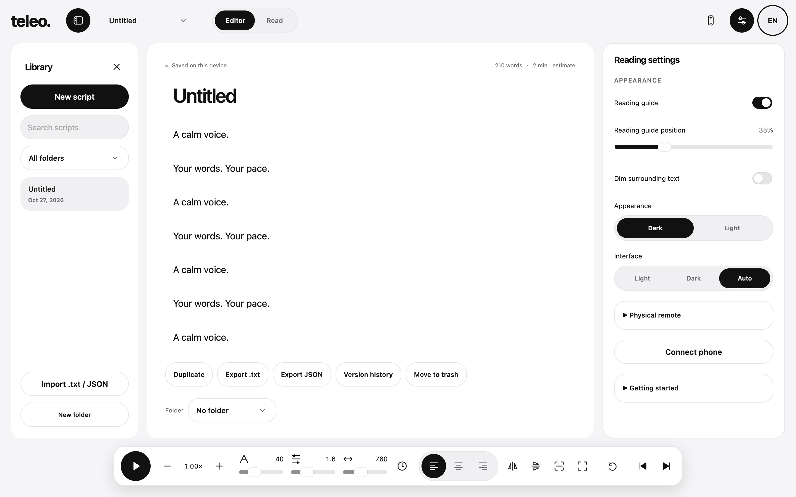
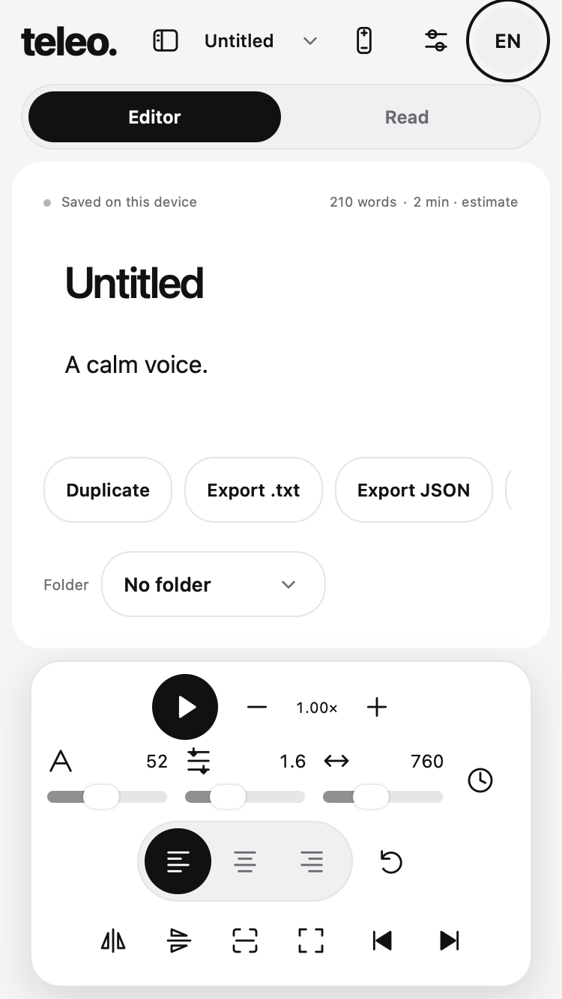
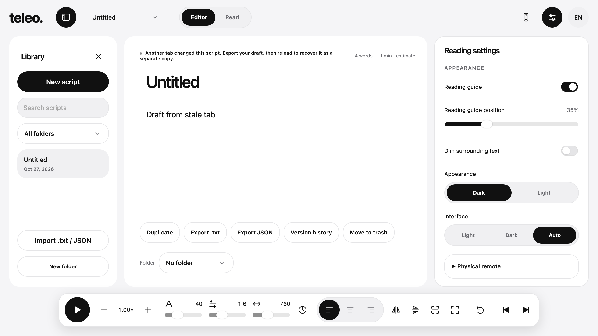
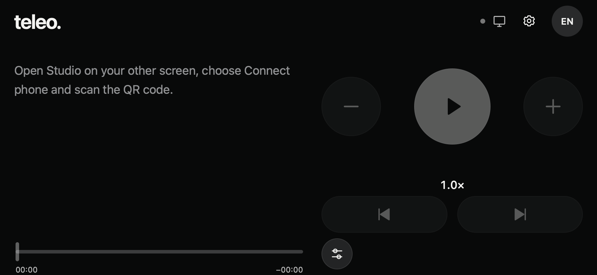
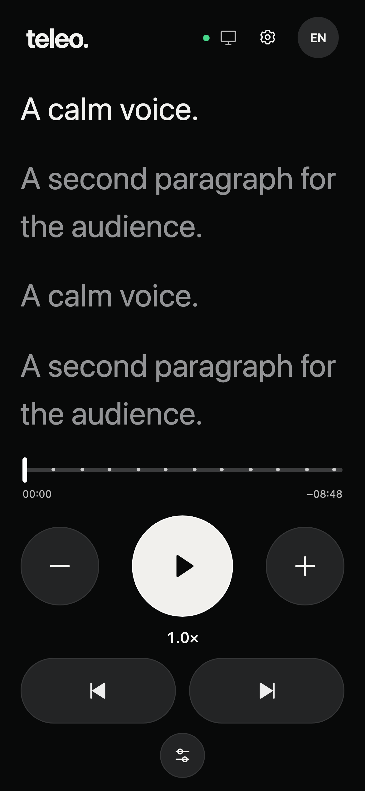
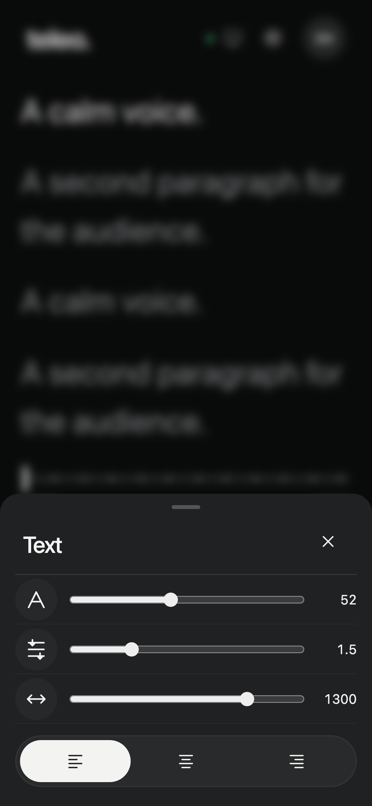
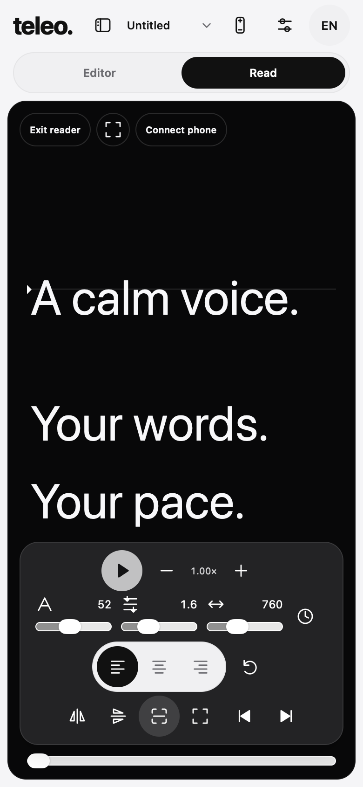
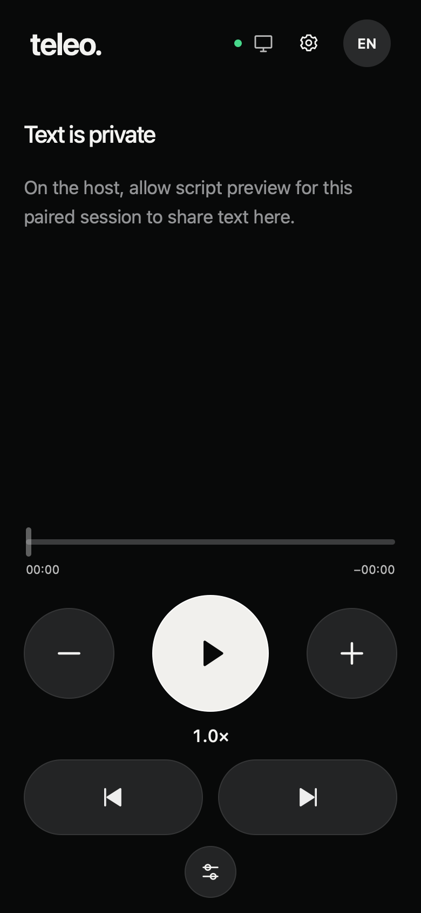
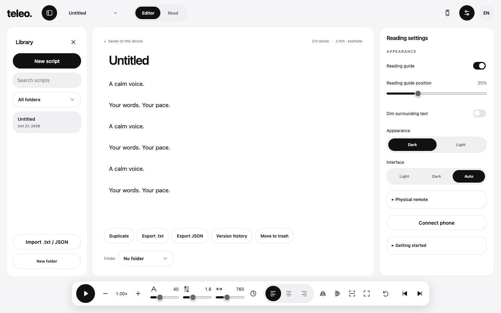

# TELEO fix verification — 2026-10-27

## Scope and authorization

The owner requested comprehensive code audit, implementation, tests and **publication to production**. This separately authorizes staging, normal GitHub PR/merge and the existing production workflow. No force push, history rewrite, personal library modification, DNS change, secret mutation or Durable Object migration is needed.

Baseline source `1327b306e0f4782823dce9890a19effbe071d148` includes the previously verified local Welcome feature. Production before this task: source `186c4e7d826b73d64e62810ca70d635311354dcd`, tag `v1.0.1`, Worker version `6b4a7ee8-b088-4f16-91cd-ed2b12aea812` at 100%. Staging before: `a1860272-8875-44be-8f6d-ae0426863cab`. API readback confirmed these versions after Wrangler refreshed its expired OAuth session normally.

## Baseline and regression evidence

| Check | Before corrections | After corrections |
|---|---|---|
| Typecheck / lint / production build | PASS | PASS, including final production dry-run |
| Vitest | 96/96, 10 files | 106/106, 11 files, 239.53s |
| Default Playwright | 174/174 | 186/186, 3.2 minutes |
| New audit browser matrix | Not present | 18/18 Chromium/WebKit/Firefox, 1.4 minutes |
| Native XCTest | 10/10 | 13/13 (10 core, 3 real TLS transport) |
| macOS / iOS Simulator builds | Existing build paths reviewed | Both final builds SUCCEEDED; no implicit strong-capture warning remains (only standard no-AppIntents metadata notice) |
| npm audit | 0 critical/high/moderate/low vulnerabilities | Dependencies unchanged |

Four new TypeScript regression cases fail on baseline: concurrent edit overwrite, deleted-record resurrection, paused out-of-range position, conflict status. Native paused-position and >1000-command tests also fail before correction. The new real TLS replacement-session test was separately run against the original NativeRemote.swift: stale completion erased the replacement invitation and subsequent pairing timed out (3 assertions). The same test and the entire 13-test suite pass on corrected code.

A real Durable Object accepted and ACKed **1005 commands** over ~79 seconds, then rejected replay of the very first ID while keeping the session usable. Existing runtime tests exercise hibernation/restart, invite expiry, wrong Origin/role/capability, revoke, resume, rate limits, stale ACKs and privacy. IDs now have individual durable keys; no script text is added to storage.

The first broad post-change browser run was invalidated by an editing/HMR overlap: 176 passed, 4 failed while Vite reloaded an active client during source edits. These failures are retained as diagnostic evidence, not called a passing run. A full fresh run on unchanged source is required and recorded below; assertions were not weakened.

## Visual verification

Real browser screenshots, generated from isolated test libraries. Matrix: 1440×900, 1280×800, 1024×768, 834×1112, 390×844, 375×667, landscape 844×390. Inspect editor, reader, remote, language menu and conflict status. Finite animations are completed for screenshots; functional playback assertions run normally. Small-width editor shots close the intentionally open desktop library before capture.






These are WebKit automation screenshots, not physical iPhone or real Safari certification. No layout/CSS redesign was needed. The full v0.7 QR suite also decodes the final branded composited QR and rendered image using Apple CoreImage; physical camera scanning of the new release remains a manual device check.

## Release gate

Pending final local/staging verification and normal PR merge. Do not interpret this section as publication evidence until concrete commit/version IDs and public test results are recorded.

Rollback to preceding production version (only if needed):

```sh
WRANGLER_SEND_METRICS=false npx wrangler rollback 6b4a7ee8-b088-4f16-91cd-ed2b12aea812 --config wrangler.jsonc
```

No schema migration or namespace replacement: previously deployed rooms retain their legacy replay ledger, while new IDs use separate keys. Existing local script records and the Welcome v2 database remain compatible. Old open tabs can continue running the previous JavaScript until reloaded; they do not acquire new client-side conflict guards until refresh. Export important drafts before closing old tabs.


Additional boundary verification: portable JSON validation is reused for local recovery metadata/preferences, while local TXT text is preserved separately up to the existing 10MB input budget. The 2,000,001-character regression initially failed under the portable cap and passes after correction. A browser stress fixture intentionally uses a single 2MB word and allows a separate 90-second layout budget; all content/persistence assertions remain strict. A failed attempt to run against a test-owned server after that runner exited produced connection-refused setup failures; the final run uses the configured managed webServer lifecycle. A normal 30-second timeout on that stress fixture is recorded, rather than described as functional data loss.

The extension-preference regression checks an imported script with a nested vendor preference: structured cloning must not prevent its next normal edit. The guard compares preserved serialized preference values instead of object identity. This is included alongside stale-tab/tombstone rejection, so the correction does not weaken concurrency protection.


## Final local commands and results

- `npm run typecheck`, `npm run lint`, `npm run build`, `npm run production:check`: PASS. Final JS 373.60 kB / 116.13 kB gzip (baseline 370.54 / 115.21); CSS unchanged 52.16 / 10.77. No dependency added or upgraded; npm audit zero vulnerabilities.
- `npm test`: **106/106**, 11 files, 239.53 seconds. Includes real 120-second invitation expiry, replay persistence through hibernation/restart, bounded reconnect and 1005 commands with ACKs.
- `npm run test:e2e`: **186/186**, 3.2 minutes on final app/Worker source. Includes real relay, offline SW, CRUD/import/export/revisions, all locales, Welcome and new audit cases. The earlier 185/186 run hit the 30-second stress-case deadline; the ordinary assertions were unchanged and the explicit large-case budget is documented above.
- `npx playwright test --config playwright.full-audit.config.ts`: **18/18** in Chromium/WebKit/Firefox, 1.4 minutes, same final application source.
- `npx playwright test --config playwright.v07.config.ts`: **33/33**, Chromium/WebKit/Firefox. Final branded QR/native canvas and rendered sizes decoded with CoreImage; live pairing, authorization, state/locale sync, revoke, expiry, failure handling and seven viewport states checked.
- `npx playwright test --config playwright.welcome.config.ts`: **18/18**, Chromium and iPhone-profile WebKit. Fresh launch/three languages, reload/edits, simultaneous tabs, deleted/disabled demo, explicit restore, returning/legacy libraries and playback.
- `swift test --package-path apps/apple --scratch-path /private/tmp/teleo-full-swift-build`: **13/13** XCTest (10 core, 3 real TLS-PSK transport), including wrong key, approval/ACK/revoke and replacement-session race. No claim is based on the auxiliary Swift Testing footer that reports 0 tests.
- macOS arm64 and generic iOS Simulator `xcodebuild ... CODE_SIGNING_ALLOWED=NO build`: **BUILD SUCCEEDED**. No Developer Team or provisioning changes. Native distribution not performed.

The observed large-document performance limitation is A11 OPEN; passing full-content persistence does not imply fast mobile editing of a multi-megabyte single word. Normal scripts and layouts retain the approved interface.

## Additional inspected screenshots







Local recovery validates up to 10,000,000 characters without applying the smaller portable JSON body cap; TXT file imports retain the existing 10MB byte-size limit. Existing large content is not silently rewritten or truncated.


Final isolated Chromium stress check with tracing disabled: **1/1 PASS**, 27.8s case / 31.2s process. This confirms A11 deserves an explicit performance limitation rather than attributing the entire delay to tracing.

## Changed files in the release

Includes the previously local Welcome commit and the audit fixes; historical generated screenshots were restored. No unrelated user changes existed at task start.

- `README.md`
- `apps/apple/Shared/NativeRemote.swift`
- `apps/apple/Shared/Reader.swift`
- `apps/apple/Sources/TeleoCore/Domain.swift`
- `apps/apple/Tests/TeleoCoreTests/CoreTests.swift`
- `apps/apple/Tests/TeleoRemoteTests/TransportTests.swift`
- `apps/web/public/_headers`
- `apps/web/src/RemoteController.tsx`
- `apps/web/src/drafts.ts`
- `apps/web/src/host-preview.ts`
- `apps/web/src/i18n.ts`
- `apps/web/src/main.tsx`
- `apps/web/src/storage.ts`
- `apps/web/src/welcome.ts`
- `docs/audits/TELEO_FIX_VERIFICATION.md`
- `docs/audits/TELEO_FULL_CODE_AUDIT.md`
- `docs/features/TELEO_DEMO_ONBOARDING.md`
- `package-lock.json`
- `package.json`
- `packages/protocol/domain.ts`
- `playwright.full-audit.config.ts`
- `playwright.welcome.config.ts`
- `services/remote-relay/worker.ts`
- `tests/e2e/approved.spec.ts`
- `tests/e2e/audit.spec.ts`
- `tests/e2e/compact.spec.ts`
- `tests/e2e/full-audit.spec.ts`
- `tests/e2e/offline.spec.ts`
- `tests/e2e/product.spec.ts`
- `tests/e2e/production.spec.ts`
- `tests/e2e/reconnect.spec.ts`
- `tests/e2e/redesign.spec.ts`
- `tests/e2e/staging.spec.ts`
- `tests/e2e/v031.spec.ts`
- `tests/e2e/v06.spec.ts`
- `tests/e2e/v061.spec.ts`
- `tests/e2e/v07.spec.ts`
- `tests/e2e/welcome.spec.ts`
- `tests/full-audit.test.ts`
- `tests/relay.test.ts`
- `tests/welcome.test.ts`

Screenshots: 25 selected `docs/screenshots/full-audit-*.png` files covering the required viewport matrix, approved remote states, conflict preservation and preview privacy. Public evidence screenshots will be added after deployment.
